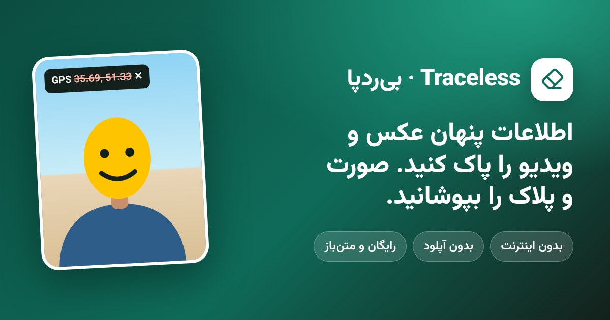
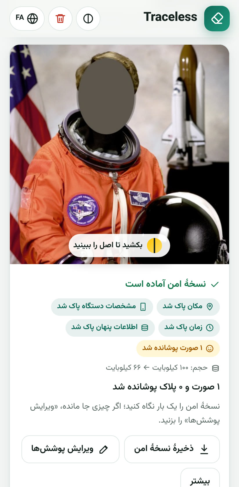
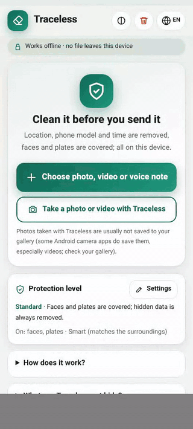
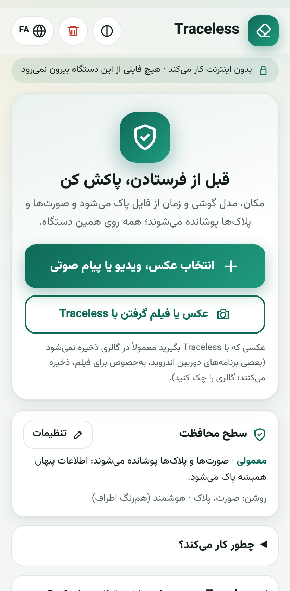
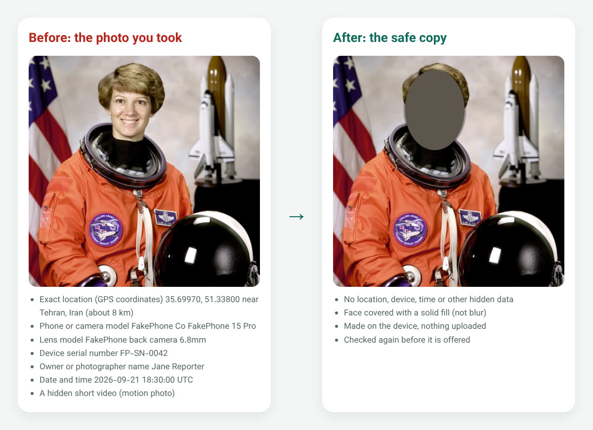

# Traceless (بی‌ردپا): حذف متادیتا و لوکیشن عکس و ویدیو و پوشاندن صورت، بدون اینترنت

[English](README.md) · **فارسی** · [Türkçe](README.tr.md)

عکس، ویدیو یا پیام صوتی را پیش از فرستادن امن کنید؛ با یک بار انتخاب و کاملاً بدون اینترنت. Traceless اطلاعات
پنهانی را که نشان می‌دهد فایل کجا، کِی و با چه دستگاهی ساخته شده پاک می‌کند: متادیتا (EXIF)، موقعیت مکانی (GPS)،
مدل و شمارهٔ سریال گوشی و تاریخ. صورت‌ها، پلاک ماشین‌ها و نوشته‌ها را هم با رنگ یکدست می‌پوشاند. رایگان و متن‌باز
است و هیچ فایلی را جایی آپلود نمی‌کند.

**استفاده:** https://pouyamsmartcity.github.io/traceless/fa/

یک بار با اینترنت باز کنید؛ از آن به بعد بدون اینترنت هم کار می‌کند. می‌توانید آن را به صفحهٔ اصلی گوشی اضافه
کنید تا مثل یک برنامه باز شود.

## ببینید چطور کار می‌کند

  
  
  

عکس نمونه پرترهٔ عمومی ناسا است و همهٔ اطلاعات پنهانی که نشان داده شده (مکان، گوشی، نام) ساختگی است.

## چه کار می‌کند

- **بدون اینترنت.** همه‌چیز روی گوشی یا کامپیوتر خود شما انجام می‌شود. صفحه اجازهٔ وصل شدن به هیچ سروری را
  ندارد؛ حساب کاربری و آمارگیری هم ندارد.
- **عکس از نو ساخته می‌شود.** عکس از روی رنگ پیکسل‌ها در یک فایل کاملاً تازه کشیده می‌شود. لوکیشن، مدل گوشی،
  شمارهٔ سریال، نام صاحب، تاریخ‌ها، تصویر کوچک پنهان، تاریخچهٔ ویرایش، اعتبارنامهٔ محتوا (C2PA)، ویدیوی پنهانِ
  «عکس متحرک» و باقی‌ماندهٔ اسکرین‌شات‌های بریده‌شده در فایل تازه نیستند. فایل تازه پیش از تحویل دوباره بررسی
  می‌شود.
- **پوشاندن صورت و پلاک در عکس و ویدیو.** صورت‌ها (حتی صورت‌های کوچک در شلوغی) و پلاک ماشین‌ها، از جمله پلاک
  ایرانی، روی خود دستگاه پیدا و پوشانده می‌شوند. پوشش یکدست است، نه محو یا شطرنجی، چون محو و شطرنجی را گاهی
  می‌شود برگرداند. در ویدیو، هر صورت در همهٔ فریم‌ها دنبال و پوشانده می‌شود.
- **پوشاندن نوشته و کل بدن آدم‌ها** (در صورت نیاز): تابلوی مغازه و خیابان، اسم و شماره؛ و بدن، لباس و مو.
- **تغییر یا حذف صدا** در ویدیو و پیام صوتی. صدای بم‌تر جلوی شنوندهٔ معمولی را می‌گیرد، نه کسی که با ابزار روی
  آن کار کند؛ مطمئن‌ترین راه حذف صداست.
- **محافظت بیشتر** در برابر شناختن دوربین از روی الگوی نامرئی حسگرش.
- **بریدن ویدیو و عکس،** پاک کردن همه‌چیز با یک دکمه، و «فراموشی خودکار» پنج دقیقه بعد از بیرون رفتن از برنامه.
- **مهروموم کردن فایل اصلی** با رمز، تا اگر روزی لازم شد نشان دهید فایل منتشرشده از کدام عکس واقعی آمده، بی‌آن‌که
  فایل اصلی را بفرستید.
- **به سه زبان:** فارسی، انگلیسی و ترکی.

## چه چیزهایی را نمی‌تواند پنهان کند

Traceless هیچ‌وقت نمی‌گوید فایلی «صددرصد امن» است. این‌ها را پنهان نمی‌کند:

- آنچه در خود تصویر دیده می‌شود: تابلوها، ساختمان‌های آشنا، سایه‌ها، بازتاب در شیشه و عینک، لباس و خالکوبی؛
- صورت یا پلاکی که پیدا نشده باشد؛ پیش از فرستادن همیشه خودتان به تصویر نگاه کنید؛
- ردّ حسگر دوربین (با «محافظت بیشتر» خیلی سخت‌تر می‌شود، اما ناممکن نه)؛
- کلمه‌ها، لهجه و صداهای پس‌زمینه در ویدیو (صدا را می‌شود تغییر داد یا حذف کرد)؛
- نسخه‌هایی که پیش‌تر جایی فرستاده‌اید.

جزئیات کامل (به انگلیسی): [docs/SECURITY.md](docs/SECURITY.md).

## برای برنامه‌نویس‌ها و دستیارهای هوش مصنوعی

Traceless ابزار خط فرمان و سرور [MCP](https://modelcontextprotocol.io) هم دارد تا اسکریپت‌ها و دستیارهای هوش
مصنوعی (Claude، Cursor و دیگران) بتوانند فایل‌های روی کامپیوتر را بررسی و پاک کنند؛ آن هم کاملاً بدون اینترنت.
راهنما: [docs/API.md](docs/API.md). جزئیات فنی و ساخت: [README.md](README.md).

## گزارش مشکل امنیتی

اگر راهی پیدا کردید که فایل پاک‌شده هنوز چیزی را لو بدهد، لطفاً آن را عمومی گزارش نکنید؛ [SECURITY.md](SECURITY.md)
را ببینید.

نرم‌افزار آزاد (MIT)، از [پویام](https://www.pouyam.com).

